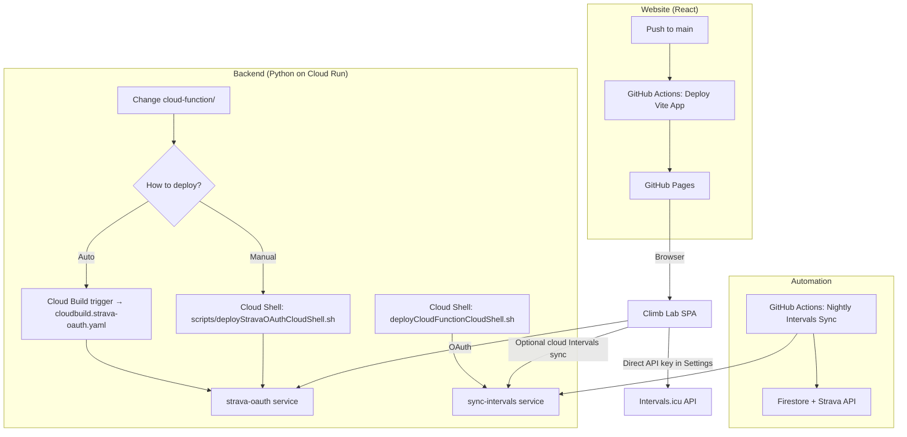

# Cloud Run in Climb Performance Lab — when you need it

This app uses **three separate deploy paths**. They are independent.

## What each service does

| Service | Purpose | Needed when |
|---------|---------|-------------|
| **GitHub Pages** | Hosts the React app | Always (this is your website) |
| **sync-intervals** | Server-side Intervals.icu proxy | Nightly sync; Dashboard eFTP chart; app sync **without** local Intervals API key |
| **strava-oauth** | Strava OAuth + token storage in Firestore | Settings → Connect Strava; Strava enrich; nightly Strava refresh |

## Decision: do I need Cloud Run?

| Your situation | Cloud Run needed? |
|----------------|-------------------|
| Only editing UI / frontend | **No** — GitHub Pages is enough |
| You use Intervals API key in Settings + manual sync only | **Partly** — nightly sync still calls `sync-intervals` |
| You use Strava connect + enrich | **Yes** — `strava-oauth` |
| You want zero Google backend | **No** — but you must disable nightly sync and Strava server OAuth |

## Decision: auto-deploy trigger vs manual

| Choice | When |
|--------|------|
| **Keep Cloud Build trigger** (fixed `cloudbuild.strava-oauth.yaml`) | You change `cloud-function/` regularly |
| **Disable trigger** | You only change React; Python backend is stable |
| **Manual Cloud Shell deploy** | Occasional Python updates; simplest IAM |

## Common build mistakes

| Symptom | Cause | Fix |
|---------|-------|-----|
| `pnpm install` / `ERR_PNPM_OUTDATED_LOCKFILE` | Trigger builds **repo root** (Vite), not `cloud-function/` | Use `cloudbuild.strava-oauth.yaml` or source dir `cloud-function` |
| `gcloud run deploy` then inner "Building Container failed" | Nested buildpack from CI | PR uses explicit Docker build in `cloudbuild.strava-oauth.yaml` |
| Empty **Triggers** tab on Cloud Run service | That tab is **Eventarc**, not GitHub build | Use **Cloud Build → Triggers** |

## IAM (if Cloud Build still fails)

Grant the **Cloud Build service account** (e.g. `PROJECT_NUMBER@cloudbuild.gserviceaccount.com`):

- Cloud Run Developer
- Service Account User (on the Cloud Run runtime SA)
- Artifact Registry Writer (on `cloud-run-source-deploy`)

See [STRAVA_OAUTH.md](./STRAVA_OAUTH.md) for deploy steps.
