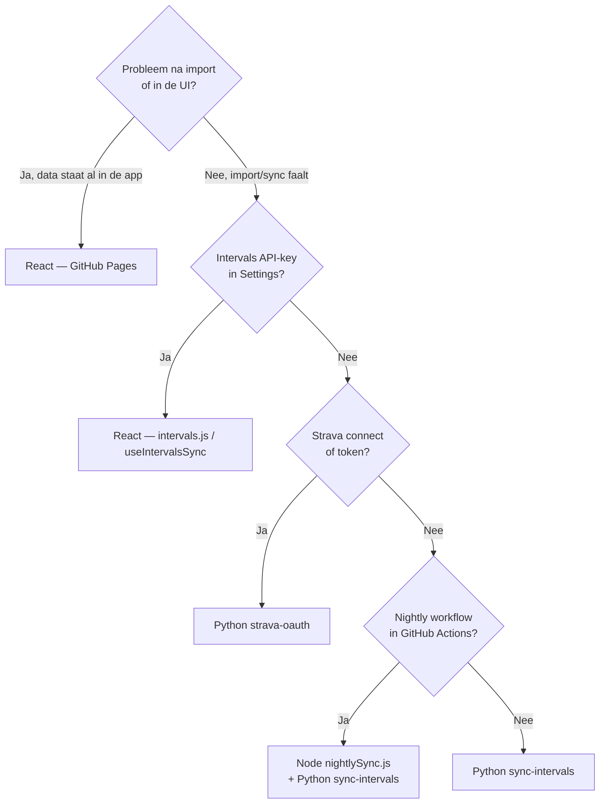

# Checklist: React vs Python vs overig

Snelle gids: **waar zit het probleem** en **wat moet je deployen**?

Gebruik dit als je Strava gekoppeld hebt en (optioneel) nightly sync aan staat.

## Eerst: welke import-route gebruik je?

| Route | Wanneer actief | Technologie |
|-------|----------------|-------------|
| **A — Handmatig in de app** met Intervals API-key in Settings | Jij klikt Sync in DataHub | **React** (`useIntervalsSync.js` → `intervals.js`) |
| **B — Cloud sync in de app** zonder lokale API-key | Ingelogd met Google, geen key in Settings | **Python** `sync-intervals` + **React** (`intervalsCloudApi.js`) |
| **C — Nightly sync** (GitHub Actions) | Workflow draait ’s nachts | **Node** (`scripts/nightlySync.js`) → **Python** `sync-intervals` + Firestore/Strava |

Als je niet zeker bent: Settings → Intervals.icu → staat er een API-key? **Ja = route A**, **nee = route B of C**.

---

## Symptoom → waarschijnlijke oorzaak

### Website & activiteitenlog (na import)

| Symptoom | Waarschijnlijk | Waar kijken |
|----------|----------------|-------------|
| Verkeerde sorteervolgorde (afstand, datum, TSS) | **React** | `src/utils/activitySort.js`, `useActivityFilter.js` |
| Export Excel/CSV: tijd of afstand ziet er raar uit | **React** | `src/utils/activityCsvExport.js` |
| Kolommen tonen `-` terwijl data er wél is | **React** | `ActivityTable.jsx`, `config.js` (`activityColumns`) |
| Filter “Strava linked” / chips werken niet | **React** | `useActivityFilter.js` |
| Duplicaten in de lijst | **React** | `src/utils/dedup.js`, `duplicateDetection.js` |
| CSV-import uit Garmin/Intervals-bestand mis | **React** | `src/utils/parsers.js`, `ImportSection.jsx` |
| Thema, layout, teksten, navigatie | **React** | `src/components/` |

**Deploy:** push naar `main` → GitHub Actions **Deploy Vite App** (GitHub Pages). Geen Cloud Run.

---

### Intervals.icu import

| Symptoom | Route | Waarschijnlijk | Waar kijken |
|----------|-------|----------------|-------------|
| Sync in app faalt direct; je hebt API-key in Settings | A | **React** | `useIntervalsSync.js`, `intervals.js` |
| Verkeerde velden na handmatige sync (met API-key) | A | **React** | `src/utils/intervals.js` (`normalizeIntervalsActivity`) |
| “Sign in with Google” / cloud sync fout | B | **React** + auth | `intervalsCloudApi.js`, Firebase login |
| Cloud sync 401/403/500 | B | **Python** of secrets | Cloud Run `sync-intervals`, `auth_gate.py` |
| Nightly sync: geen nieuwe activiteiten | C | **GitHub Actions** of **Python** | Actions log, `nightlySync.js`, `main.py` |
| Nightly: activiteiten wel, maar verkeerde power/load/type | C | **Python** | `cloud-function/main.py` (`transform_activity`) |
| Alleen indoor/Zwift verkeerd getypeerd | A/B/C | **React** én mogelijk **Python** | `intervals.js` (A) of `main.py` (B/C) |

**Deploy route A:** alleen GitHub Pages.  
**Deploy route B/C (server):** Cloud Shell → `scripts/deployCloudFunctionCloudShell.sh` of deploy `sync-intervals` (zie `cloud-function/README.md`).

---

### Strava

| Symptoom | Waarschijnlijk | Waar kijken |
|----------|----------------|-------------|
| Settings → Connect Strava: redirect/error na inloggen | **Python** + config | `strava_oauth.py`, Cloud Run env `STRAVA_*` |
| “Unauthorized” bij Strava-connect | **Python** + **React** | Firebase login, `auth_gate.py`, `stravaCloudApi.js` |
| Connected, maar enrich in DataHub faalt | **React** (meestal) | `useDataHubStravaEnrich.js`, `stravaSelectedEnrich.js` |
| Token verlopen / refresh faalt in de app | **Python** | `strava_token_manager.py`, Firestore `strava_tokens/` |
| Nightly: `[STRAVA]` overgeslagen of enrich faalt | **GitHub secrets** + **Node** | Repo secrets `STRAVA_*`, `scripts/stravaTokenManager.js`, Firestore token doc |
| Strava API rate limit in enrich | **React** | `stravaSelectedEnrich.js` (te veel parallel requests) |

**Deploy Strava OAuth:** Cloud Shell → `scripts/deployStravaOAuthCloudShell.sh` (niet nodig bij alleen frontend-fix).

---

### Dashboard, coach, physics, race, gear

| Symptoom | Waarschijnlijk |
|----------|----------------|
| Grafieken, eFTP-trend, berekeningen in tabs | **React** (`src/components/`, `src/utils/analytics.js`) |
| eFTP via cloud service (zonder lokale key) | **React** `intervalsCloudApi.js` + **Python** `sync-intervals` | Cloud Run / `cloud-function/main.py` |

---

### Weer (Weather Climb-tab)

| Symptoom | Waarschijnlijk | Waar kijken |
|----------|----------------|-------------|
| Weerdata laadt niet | **Python** proxy of API-key | `weather_proxy.py`, Cloud Function `openweather-proxy` |
| Berekening met temperatuur/wind klopt niet | **React** | `WeatherClimb.jsx`, `calculations.js` |

---

### Sync & data opslag

| Symptoom | Waarschijnlijk | Waar kijken |
|----------|----------------|-------------|
| Data verdwijnt op ander apparaat | **Firebase** / login | `App.jsx`, Firestore sync |
| Strava-tokens leesbaar in browser (security) | **Firestore rules** | `firestore.rules` — geen Python |
| Alleen lokaal zichtbaar, niet in cloud | **React** + Firebase | sync-logica in `App.jsx` |

---

## Snelle beslisboom

---

## Wat deploy je wanneer?

| Je hebt gewijzigd | Deploy-actie |
|-------------------|--------------|
| `src/**` (React) | Push `main` → wacht op **Deploy Vite App** |
| `cloud-function/**` (strava-oauth) | Cloud Shell: `bash scripts/deployStravaOAuthCloudShell.sh` |
| `cloud-function/**` (sync-intervals) | Cloud Shell: zie `cloud-function/README.md` |
| `scripts/nightlySync.js` | Push `main` (geen Cloud Run); volgende nightly run pakt het op |
| `firestore.rules` | `node scripts/deployFirestoreRules.js` |
| Alleen secrets (Strava ID/secret) | Cloud Run Variables + GitHub Actions secrets — **geen code** |
| `cloudbuild.strava-oauth.yaml` | Alleen relevant als Cloud Build trigger **aan** staat |

---

## Typische scenario’s (jouw setup)

| Je wilt… | Waarschijnlijk… |
|----------|-----------------|
| Activity log sortering/export fixen | **React** — geen Python |
| Intervals-kolommen fixen bij sync **met** API-key in Settings | **React** (`intervals.js`) |
| Zelfde fix voor nightly sync | **Python** (`main.py`) + eventueel **React** |
| Strava opnieuw kunnen koppelen | **Python** deploy + Cloud Run `STRAVA_*` env |
| Minder Cloud Build-fouten bij frontend-only werk | Trigger **uitschakelen** (zie [STRAVA_OAUTH.md](./STRAVA_OAUTH.md)) |
| Nieuwe tab of chart | **React** |

---

## Na elke deploy (GitHub Pages)

- **Inloggen testen:** uitloggen → opnieuw **Sign in with Google** op de live site (`vccharlie.github.io`). Auth-wijzigingen zie je pas na een echte login, niet alleen door de site te openen terwijl je al ingelogd bent.
- **Service worker reset** bij vreemd gedrag (login-loop, oude UI): DevTools → Application → Service Workers → **Unregister**, daarna hard refresh (`Ctrl+Shift+R`), of op het inlogscherm **Sign-in stuck? Reset browser cache**.

---

Zie ook [CLOUD_RUN_OVERVIEW.md](./CLOUD_RUN_OVERVIEW.md) voor het grote plaatje (website vs Cloud Run vs nightly).
